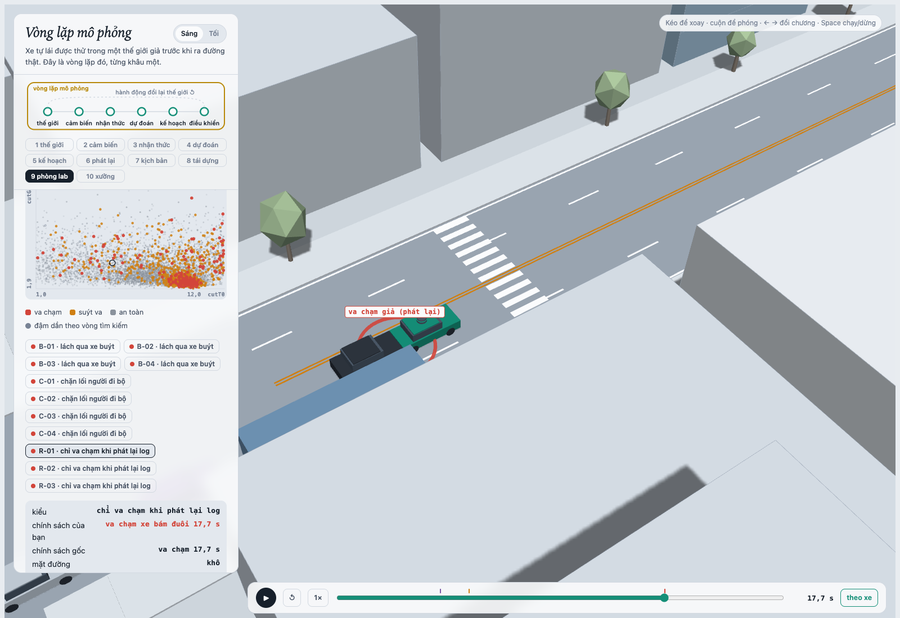
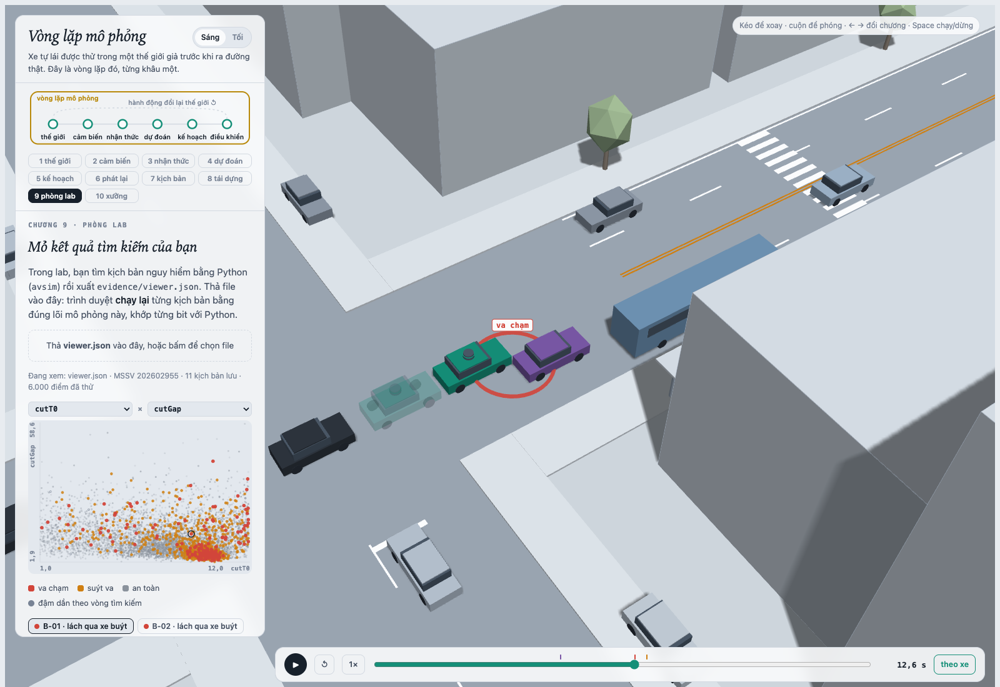
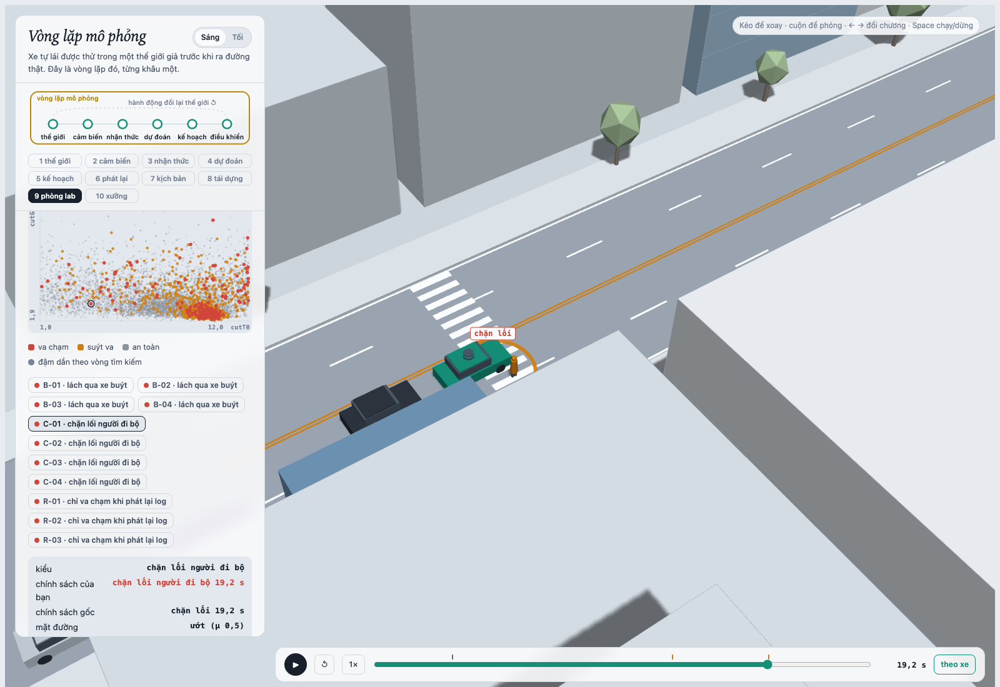
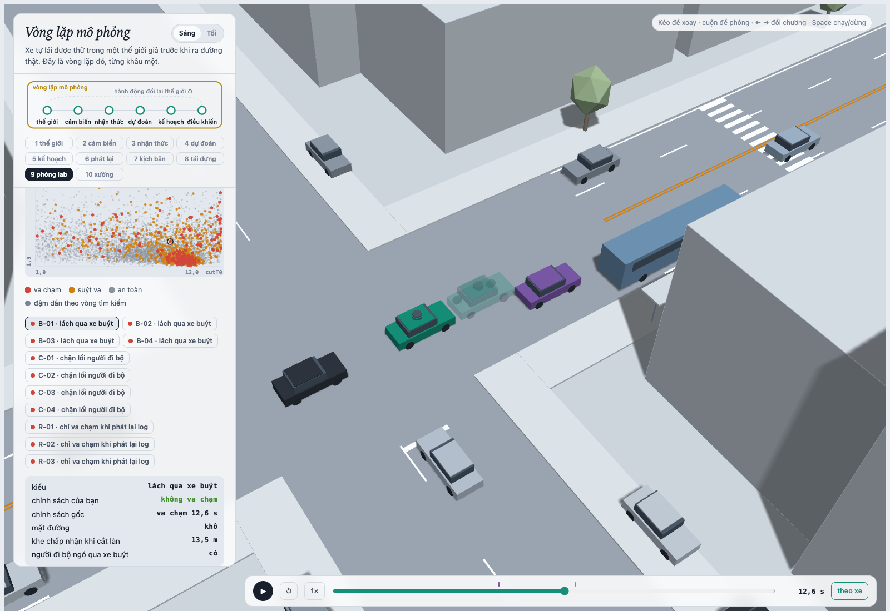
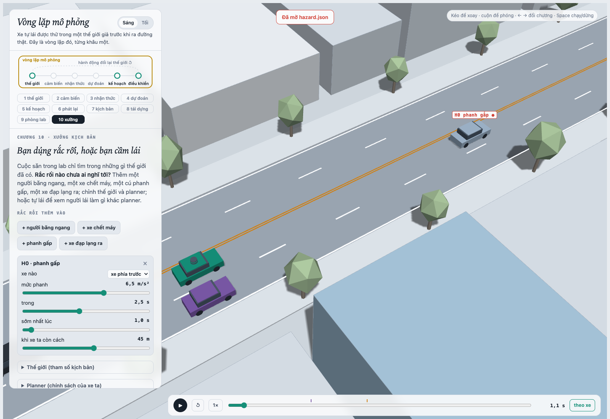

MSSV: 202602955

# Lab 11 · Scenario Forge — báo cáo

Thị trấn **A** (`meta.json: _run.town`). Seed: MC **3406166027**, search **962810914**, TEST **2928909950** (`meta.json: seeds`). Mọi bước chính thức dùng ngân sách mặc định, `quick = false`, `salted = false`; không sửa lõi, phân phối, seed hoặc ứng viên policy. Các số bên dưới được làm tròn từ JSON; JSON giữ đủ độ chính xác.

## 1. Phát lại log có trung thực không?

Nguồn: `replay.json: n, dropped_human_crash_logs, n_used, replay, reactive, crash_in_both`.

| Đại lượng | Kết quả |
|---|---:|
| Kịch bản ban đầu / được dùng | 400 / 400 |
| Bỏ do người lái gây va chạm | 0 |
| Va chạm khi phát lại | 98: 82 rear, 16 side, 0 front |
| Va chạm trong thế giới phản ứng | 1: 1 front, 0 rear, 0 side |
| Va chạm trong cả hai cách | 0 |

Planner phanh khác thời điểm người lái trong log. Khi phát lại, TG giữ nguyên quỹ đạo đã ghi nên không biết ego phanh sớm và không giảm tốc tương ứng. Phần lớn thất bại replay vì thế là rear giả: thế giới phản ứng có thể tránh chúng bằng cách phanh theo ego. Cả hai cách đều dùng cùng tham số ban đầu; sự khác biệt nằm ở phản hồi của tác nhân.

Chọn `replay_only[0]`, scenario **0**, contact **rear**. Bản reactive không thất bại, `min_ttc_reactive = 7.4606295 s`. Run **R-01** trong `viewer.json` phát lại cảnh đó: TG chạm ego lúc **17.70 s**, `fake = true` (`shots/manifest.json: replay.png`).

## 2. Kịch bản bất khả thi

`is_feasible` chỉ giữ kịch bản thỏa cả bốn luật:

| Luật | Căn cứ |
|---|---|
| `(π/cutDur)² × 3.5/2 ≤ μg` | Gia tốc ngang cực đại của chuyển làn cosine 3,5 m không vượt độ bám đường. |
| `cutBrake ≤ μg` | Phanh dọc không vượt lực ma sát có thể tạo. |
| `pedV ≤ 2.5 m/s` | Giới hạn tốc độ đi bộ của thế giới này; đây là giả định mô hình, không phải giới hạn chạy của mọi người. |
| `0 < cutV ≤ 22 m/s` | Xe chuyển làn phải đi về phía trước và nằm trong miền tốc độ đường đô thị của bài. |

Với `g = 9.81`, đường ướt có `μg = 4.905 m/s²`, đường khô có `μg = 7.848 m/s²`. `cutDur ≤ 0` cũng bị loại để không tính chuyển làn tức thời.

Nguồn `hunt.json: <mode>.infeasible`: bus_bypass **2**, cut_in **4**, crosswalk_block **9**, rear_ended **3**. Cuộc săn **crosswalk_block** sinh nhiều mẫu bất khả thi nhất. CEM ưu tiên tình huống có ít khoảng phanh/TTC, nên dễ đẩy các biến về chuyển làn quá nhanh, phanh quá mạnh hoặc tốc độ không hợp lệ. Đây là vùng tạo điểm nguy hiểm cao nhưng không có bằng chứng thất bại vật lý. Đếm chúng như tai nạn sẽ làm xác suất bị thổi phồng. Runner bỏ chúng trước mô phỏng; `mc.json: infeasible = 11` cũng được ghi lại, không tính là thất bại.

## 3. Monte Carlo cho biết gì?

Nguồn `mc.json`: **k = 6**, **n = 3000**, **p̂ = 0.002**, Wilson 95% **[0.000916918, 0.00435686]**. “Thất bại” ở đây gồm tiếp xúc và chặn lối; không phải cả sáu đều là đâm vật lý. Các kiểu: bus_bypass **5**, crosswalk_block **1**.

Muốn nửa độ rộng khoảng xấp xỉ bằng `0.2p`, cần `n ≈ 1.96²(1-p)/(0.2²p) ≈ 96/p`. Thay p̂ cho kết quả **47,924** lượt theo công thức có `(1-p)`, hoặc khoảng **48.000** lượt theo `96/p`. Đây là tính ngân sách xấp xỉ, không phải chứng nhận vì p thực chưa biết chính xác.

`cut_in`, `rear_ended`, `other` đều chưa xuất hiện. Với từng kiểu, báo Wilson **[0, 0.0012789]** (`per_mode.<mode>.hi`), không kết luận xác suất bằng 0. Nếu không thấy sự kiện, khoảng chuẩn sẽ suy biến thành [0,0]; Wilson vẫn giữ cận trên dương.

## 4. Importance sampling, ESS và suy biến

Nguồn `estimate.json: seeds[s].per[mode]`. Các dòng không có hit trình bày **cận trên**, thay cho số 0 của ước lượng điểm lưu trong JSON. Mỗi dòng có n = **600**; beta = **0.2**.

| Kiểu | Seed | p hoặc cận khi zero hit | hits | ESS | top_share |
|---|---:|---:|---:|---:|---:|
| bus_bypass | 0 | 0.000464989 | 59 | 115.76 | 0.2364 |
| cut_in | 0 | chưa thấy hit; ≤ 0.025 | 0 | 124.73 | 0.0000 |
| crosswalk_block | 0 | 7.67242e-07 | 110 | 115.32 | 0.4674 |
| rear_ended | 0 | chưa thấy hit; ≤ 0.025 | 0 | 117.11 | 0.0000 |
| bus_bypass | 1 | 0.000247324 | 50 | 110.30 | 0.3272 |
| cut_in | 1 | chưa thấy hit; ≤ 0.025 | 0 | 116.89 | 0.0000 |
| crosswalk_block | 1 | 5.05233e-05 | 83 | 126.22 | 0.9939 |
| rear_ended | 1 | chưa thấy hit; ≤ 0.025 | 0 | 112.69 | 0.0000 |
| bus_bypass | 2 | 0.000333417 | 50 | 121.34 | 0.2732 |
| cut_in | 2 | chưa thấy hit; ≤ 0.025 | 0 | 123.85 | 0.0000 |
| crosswalk_block | 2 | 3.64395e-06 | 82 | 122.14 | 0.8246 |
| rear_ended | 2 | chưa thấy hit; ≤ 0.025 | 0 | 106.19 | 0.0000 |

Tổng điểm ước lượng của ba seed là **0.000465756**, **0.000297848**, **0.000337061**; trung vị **0.000337061**. Tổng chênh khoảng **1.56 lần**, thấp hơn MC p̂ = 0.002 khoảng **5.93 lần** ở trung vị; cả ba điểm IS thấp hơn cận dưới Wilson MC. Riêng crosswalk_block chênh khoảng **65.85 lần** giữa seed cao nhất và thấp nhất. Đây là dấu hiệu chưa bao phủ tốt vùng thất bại, không có lý do chọn seed đẹp nhất.

`top_share` là phần tổng `w*y` do mẫu đóng góp lớn nhất mang. Crosswalk_block seed **1** có **0.9939**, seed **2** có **0.8246**: gần như một mẫu nặng quyết định con số. ESS ở đây đo độ lệch trọng số, không phải số thử độc lập cho kiểu đó; 83 hit vẫn không bảo đảm ước lượng vững. Seed 0 có top_share thấp hơn cũng không chứng minh q đã tìm hết các vùng va chạm.

`budget = 16800` gồm **9.600** lượt săn và **7.200** lượt IS, chưa cộng MC hoặc fix. Theo các p của bus_bypass, MC để đạt sai số tương đối ±20% cần khoảng **206.457–388.154** lượt (`96/p`). Tuy nhiên IS hiện tại **chưa đạt ±20%**: nửa khoảng chuẩn của bus_bypass bằng khoảng **67.6–73.2%** điểm ước lượng. Nếu chỉ so cùng SE danh nghĩa, `n_MC ≈ p(1-p)/se²` cho khoảng **15.399–30.063** lượt với bus_bypass; vì vậy không thể khẳng định tiết kiệm một bậc độ lớn ở độ chính xác đã chứng minh. Các phép tính này cũng phụ thuộc p và SE vốn chưa ổn định.

`other` lấy từ `mc.json` vì tập này không có một kiểu/điểm nguy hiểm riêng để săn: **k = 0, n = 3000**, cận Wilson **0.0012789** (`estimate.json: other`). Tổng bằng các kiểu cộng ước lượng điểm của other. IS zero hit dùng **3/(0.2×600) = 0.025**, không dùng `3/ESS`.

Các khoảng `seeds[s].lo/hi` là xấp xỉ của runner, không phải chứng nhận đầy đủ cho mọi kiểu: tổng `hi` hiện chưa cộng cận 0.025 của hai kiểu zero hit. Phải giữ và trình bày các cận từng kiểu; không diễn giải tổng nhỏ thành “mọi thất bại đều hiếm như vậy”.

## 5. Các kiểu thất bại

Nguồn `hunt.json: <hunt>.found`; số này đếm các mẫu thất bại đã gặp qua vòng săn, không phải số tình huống độc lập ngoài đường.

| Cuộc săn | Các kiểu đã tìm thấy |
|---|---|
| bus_bypass | 152 bus_bypass |
| cut_in | 16 bus_bypass; chưa tìm thấy cut_in |
| crosswalk_block | 106 crosswalk_block, 1 bus_bypass |
| rear_ended | 4 bus_bypass, 9 crosswalk_block; chưa tìm thấy rear_ended |

**Bus bypass — B-01, 12.60 s:** xe buýt còn đỗ; C2 tiến chậm và lấn vào làn ego để lách qua nó. Ego phát hiện/đối xử C2 như xe dẫn quá muộn khi C2 chưa sang hẳn làn, nên tiếp xúc C2. Người đi bộ chưa bắt đầu trong cảnh này. Ảnh chụp frame **252** có vòng tiếp xúc.

**Crosswalk block — C-01, 19.15 s:** P1 không ngó qua xe buýt (`pedLook = 0`), bước từ lề khi khe nhìn thấy cho phép. Xe buýt đang rời bến vẫn che khu vực; ego trên đường ướt thấy người và phanh, nhưng thân xe đã nằm trên đường đi của P1. P1 dừng trước thân xe; đó là `kind = block`, không phải người đi xuyên vào xe. Ảnh frame **383** chụp đúng lúc chặn lối. Nguồn tham số: `viewer.json: runs[id=C-01]`; sự kiện: `shots/manifest.json`.

Chưa tìm thấy cut_in và rear_ended không chứng minh chúng không tồn tại; cận IS zero hit vẫn là **0.025** từng kiểu. Chính hai cuộc săn dành cho chúng lại tìm các kiểu khác cho thấy một cuộc săn chung dễ tập trung quanh thất bại dễ tối ưu điểm nhất. Săn riêng giúp giữ được hai cơ chế bus_bypass và crosswalk_block, nhưng vẫn không bảo đảm bao phủ hết.

## 6. Sửa planner

Chọn **`{"cutinLat": 3.0}`** (`fix.json: chosen.policy`), giữ các núm khác ở policy gốc. Nhận diện xe lấn làn sớm hơn giúp ego giảm tốc trước khi C2 chặn đường. Không thêm ứng viên và không chọn theo TEST.

Nguồn các hàng: `fix.json: baseline_train, chosen, baseline_test, chosen_test`.

| Policy / tập | fail | fail_hi_seen | fail_hi | Quãng đường m | Frame phanh gấp trung bình | unseen |
|---|---:|---:|---:|---:|---:|---|
| Gốc · TRAIN | 0.000559083 | 0.00111163 | 0.00111163 | 213.576367 | 8.339844 | không |
| Chọn · TRAIN | 7.39878e-08 | 1.21257e-07 | 1.21257e-07 | 213.561887 | 7.753906 | bus_bypass |
| Gốc · TEST | 0.0019339 | 0.00357313 | 0.00485202 | 215.141002 | 8.586333 | không |
| Chọn · TEST | 3.58854e-07 | 5.67651e-07 | 0.0387795 | 215.051647 | 7.907667 | bus_bypass |

Quãng đường giảm **0.006780%** trên TRAIN, **0.041533%** trên TEST, đều dưới 5%. `harsh` đếm **frame gia tốc < −3 m/s²**, không phải số đợt phanh tách biệt. Quãng đường do runner cắt tại thất bại đầu tiên.

TRAIN dùng cùng mẫu để sàng ứng viên. `cutinLat = 3.0` và `3.3` có cùng fail_hi; 3.0 thắng vì tiến độ cao hơn. TEST dùng seed mới và săn lại riêng dưới policy chọn. Trên TEST, bus_bypass của bản sửa có zero hit nên `fail_hi` cộng **3/(0.2×400) = 0.0375**; tập tự nhiên không thấy kiểu khác vẫn cộng Wilson **0.0012788957**. Vì vậy `fail_hi = 0.0387795` có thể lớn hơn cả điểm fail của policy gốc, dù dữ liệu thấy bản sửa tốt hơn. `fail_hi_seen` nhỏ không chứng nhận đã xóa một kiểu. Với cơ chế cận này, cần cỡ **15.000** mẫu/kiểu để cận zero hit xuống khoảng 10⁻³.

Cùng B-01 tại **12.60 s**, xe đặc là bản sửa không va chạm, bóng mờ là policy gốc chạm C2. Script chỉ nạp một bản sao dữ liệu với run không ghim policy trong bộ nhớ để ghost dùng baseline; không sửa viewer hay `viewer.json`.

Một núm nghe an toàn hơn nhưng phản tác dụng: tăng **T từ 1.6 lên 2.0**. `fix.json: table[8]` có TRAIN fail **0.0142298**, fail_hi **0.0405957**, cao hơn gốc **0.000559083 / 0.00111163**. Không thể suy ra an toàn chỉ từ việc tăng khoảng cách thời gian.

Để kiểm tra cơ chế, chạy thêm một cặp **TRAIN** và lưu riêng `diagnostics.json` (phép chẩn đoán bổ sung, không dùng chọn policy). Gốc không có sự kiện ego; T=2 gây block lúc **21.85 s**. C2 bắt đầu lấn làn lúc **19.25 s** với gốc, **19.40 s** với T=2; thời điểm/quỹ đạo tương tác đã đổi. Tại frame sự kiện, tâm ego dừng ở **118.9856 m** với gốc nhưng **119.7715 m** với T=2: mũi xe thứ hai qua vị trí vạch **122 m**. P1 vẫn đi **0.6953 m/s** với gốc, nhưng phải dừng ở bản T=2. Thế giới phản ứng với vị trí thân xe; thay một núm không tạo ra quan hệ “càng lớn càng an toàn”.

## 7. Từ mô phỏng ra đường thật

Các hướng sai lệch dưới đây là giả thuyết cần đo kiểm, không phải kết luận đã hiệu chỉnh mô hình.

| Giả định thị trấn A | Dữ liệu cần thay và nguồn cụ thể | Nếu giả định sai |
|---|---|---|
| cutGap lognormal, median 12 m; hành vi chuyển làn theo khe | Trích quỹ đạo, khe trước/sau và thời điểm bắt đầu chuyển làn từ camera/drone địa phương; thử công cụ với [highD, bài công bố gốc](https://arxiv.org/abs/1810.05642), rồi hiệu chỉnh cho phố/bến xe buýt vì highD là cao tốc Đức. | Nếu ngoài đời chấp nhận khe nhỏ hơn, ego có ít thời gian ứng phó hơn, mô hình có thể đánh giá thấp rủi ro C2; tác động cần kiểm bằng thế giới phản ứng. |
| pedLook có xác suất 0.85; pedGap lognormal median 4.5 s | Video đồng bộ phía trên và sát lề ở bến xe buýt để ghi bước ra, nhìn qua đầu xe và khe xe; [inD, bài công bố gốc](https://arxiv.org/abs/1911.07602) hỗ trợ phương pháp đo quỹ đạo người/xe, nhưng không đủ để suy ra hướng nhìn đầu. | Nếu ít người kiểm tra xe bị che hơn hoặc chấp nhận khe ngắn hơn, crosswalk_block có thể bị đánh giá thấp. |
| đường ướt 20%, μ cố định 0.5/0.8 | Nhật ký mưa/mặt đường đồng bộ telemetry phanh-ABS và thử độ bám lốp/mặt đường tại tuyến; [FHWA về đặc tính đường ướt](https://highways.fhwa.dot.gov/safety/speed-management/guidelines-use-variable-speed-limit-systems-wet-weather/chapter-2-driver) nêu vai trò của độ bám trong khoảng dừng. | Nếu μ thật thấp hơn hoặc đường ướt thường xuyên hơn, khoảng phanh dài hơn và xác suất thất bại có thể bị đánh giá thấp. |

Cần ước lượng cả tương quan giữa biến, ví dụ mưa với tốc độ, khe và hành vi người đi bộ; không thay từng marginal rồi mặc định chúng độc lập.

## 8. Giới hạn

1. **Một đoạn phố, chân trời 24 s:** xác suất thuộc cấu hình thị trấn này, không bao phủ giao lộ khác, đường cong, địa hình hoặc toàn hành trình dài.
2. **Tác nhân IDM/gap acceptance:** chưa có phân bố phản ứng trễ, mất tập trung hoặc ý định đa dạng được hiệu chỉnh từ dữ liệu thật; thắng IDM không chứng minh thắng người lái thật.
3. **Nhận thức lý tưởng hóa:** lõi có che khuất hình học nhưng không mô phỏng đầy đủ detector sai, mất track, nhiễu vị trí/tốc độ và độ trễ xử lý như hệ thống thực.

Nếu thêm một tuần, ưu tiên thu dữ liệu bến xe buýt để hiệu chỉnh khe và che khuất, chạy nhiều seed độc lập với đề xuất bao phủ hơn, rồi tăng ngân sách zero hit và thử độ trễ cảm biến. Giữ holdout riêng cho việc đánh giá sau hiệu chỉnh.

## 9. Rắc rối của tôi: L1 phanh gấp

**Thiết kế:** xe dẫn L1 phanh khi gặp vật cản bất ngờ. Cảnh xuất từ chương 10: `decel = 6.5 m/s²`, `dur = 2.5 s`, `t0 = 1 s`, `trig = 45 m`, đường khô. Hazard thực sự kích hoạt ở **1.00 s**; `mine.json: exact.planner = []` khớp cảnh không va chạm. Ảnh chụp lúc **1.05 s** đang phanh, vì cảnh không có thời điểm va chạm để chụp.

**Căn cứ thử:** planner IDM có mức phanh thoải mái b=2 m/s² trong khi L1 có thể phanh mạnh hơn; muốn kiểm tra ego có dùng đủ độ bám khi xe trước dừng đột ngột không. Kết quả cho thấy tình huống đã được xử lý tốt trong dải đã thử, không phải một lỗi mới đã chứng minh.

**Giả định có nguồn:** [NHTSA DOT HS 810 846, Table 34, trang in 88 / PDF trang 117](https://www.nhtsa.gov/sites/nhtsa.gov/files/analyses20of20rear-end20crashes20and20near-crashes2028dot20hs208102084629.pdf) cho 9 sự kiện/1.000 mile trên 0.45g và 0.3 trên 0.70g. Lấy hiệu **8.7/1.000 mile** cho dải phanh 0.45–0.70g, tương ứng `h0_decel = [4.4145, 6.867]`. `h0_dur = [2,3] s` bao quanh thời gian dừng `12.4/a ≈ 1.81–2.81 s`. `h0_trig = [40,50] m` là dải thiết kế quanh khoảng dừng ở 12 m/s theo giả định phản ứng 2.5 s, phanh 3.4 m/s² của [FHWA, mục 3.6.1](https://www.fhwa.dot.gov/publications/research/safety/04091/03.cfm): khoảng **51.18 m**. Dur/trig và phân bố đều là lựa chọn stress-test có căn cứ vật lý, chưa phải phân bố thực nghiệm.

Quy ước một chuyến tham chiếu **300 m**, một xe dẫn có tần suất phanh tương tự mẫu NHTSA: `exposure = 8.7 × (0.3/1.609344)/1000 = 0.00162178` sự kiện/chuyến (`hazard.json: why`). Đây là suy ra từ dữ liệu Mỹ cũ, chưa đo tại thị trấn A hay Việt Nam; chưa hiệu chỉnh xác suất đang bám một xe dẫn. So sánh tần suất bên dưới chỉ có ý nghĩa dưới giả định chuyển đổi này. Mẫu phanh vượt μg trên đường ướt bị loại, nên kết quả sweep có điều kiện trên tập khả thi.

Nguồn `mine.json: baseline, chosen, accepted, infeasible`:

| Policy | n giữ lại | Tổng va chạm ego | avoidable | unavoidable | unattributed | low_speed | avoidable_foreknown |
|---|---:|---:|---:|---:|---:|---:|---:|
| Gốc | 1215 | 2 | 0 | 0 | 2 | 0 | 0 |
| cutinLat = 3.0 | 1215 | 0 | 0 | 0 | 0 | 0 | 0 |

**Accepted = 0.81**, giữ **1.215/1.500**, loại **285**; không có chồng thân xe lúc bắt đầu. Hai va chạm gốc đều với C2, `examples[*].fire_t = null`: thẻ phanh chưa bắt đầu, nên không được quy cho hazard. Bản sửa tránh các thất bại thông thường đó, nhưng chưa có dữ liệu chứng minh nó sửa thêm một lỗi phanh gấp.

Với mỗi policy, chưa thấy lỗi planner do hazard; báo **Wilson 95% [0, 0.00315185]** cho tỷ lệ trên mẫu khả thi, thay vì kết luận xác suất bằng 0. `avoidable` là phanh từ frame đầu hazard đã hoạt động **và nhìn thấy**, còn `avoidable_foreknown` cho phép phanh từ lúc bắt đầu ngay cả khi bị che; cả hai đều không có hit ở đây. Denominator còn gồm cảnh hazard chưa kích hoạt, nên không gọi đây là tỷ lệ có điều kiện riêng trên “đã phanh thật”.

Theo exposure giả định, cận trên tần suất lỗi mỗi chuyến là **5.1116e-06** cho cả hai policy (`per_trip_hi`). Đặt cạnh bus_bypass: MC **5/3000 = 0.00166667** (`mc.json: modes.bus_bypass`), trung vị IS **0.000333417**. Trong phép quy đổi screening này, chưa có bằng chứng hazard phanh gấp nguy hiểm hơn lách xe buýt. Không coi thứ tự này là so sánh rủi ro thật đã hiệu chỉnh: đơn vị chuyến tham chiếu 300 m, cửa sổ mô phỏng 24 s, phân bố đều stress-test và uncertainty của exposure vẫn khác nhau.

`avoidable` là chuẩn lạc quan vì oracle biết ngay khi nhìn thấy và phanh tối đa, bỏ qua thời gian nhận dạng/quyết định: nó có thể đếm nhiều hơn số vụ một planner thực tránh được. Ngược lại, oracle chỉ thử phanh, không đánh lái, nên có thể bỏ sót vụ tránh được bằng cách khác. `unavoidable` vì thế nghĩa là không cứu được bằng oracle phanh đã thử, không phải bất khả tránh bằng mọi hành động. `unattributed` là tai nạn chưa liên hệ với thẻ; `low_speed` là cờ bổ sung, không phải loại thứ tư.

**Tự lái:** chưa thực hiện lượt người lái thủ công; không báo kết quả tránh được do người lái. **Cách sửa tiếp nếu xuất hiện lỗi:** giữ nhận diện C2 sớm bằng cutinLat=3.0; bổ sung dự báo xe dẫn phanh mạnh và một ràng buộc khoảng dừng dùng μ ước lượng, thay vì chỉ tăng b hoặc T rồi mặc định an toàn. Kiểm tra cả xe phía sau khi can thiệp phanh để không chuyển lỗi sang bị tông đuôi. Hiện không có bằng chứng cần đổi núm riêng cho hazard này.

---

Bài nộp gồm `lab11/*.py`, `hazard.json`, `evidence/*.json`, năm ảnh thật trong `evidence/shots/` và báo cáo này. Ảnh/manifest được tạo từ viewer nguyên bản; script tái tạo và kiểm tra ở `scripts/`. Kiểm tra cuối: 31 test TODO, 6 test biên, 10 test parity; đối chiếu toàn bộ bằng `python3 scripts/check_submission.py`.
